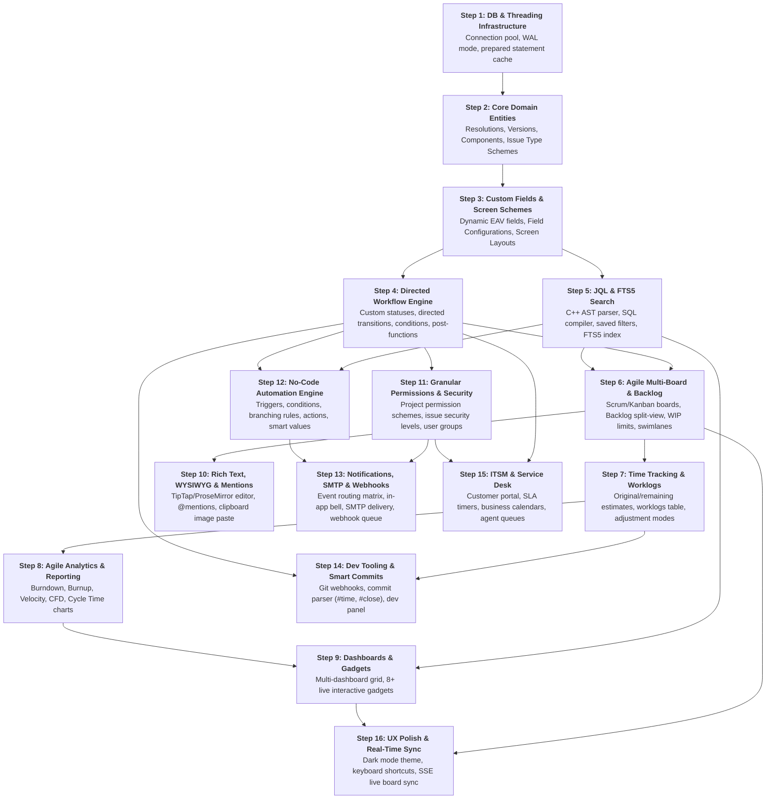

# Jira Parity Roadmap & Feature Specification (`TODO.md`)

This document provides a comprehensive gap analysis and exhaustive development roadmap for **`jiralike-demo`** to achieve complete feature parity with **Atlassian Jira** (Jira Software, Jira Work Management, and Jira Service Management).

---

## Table of Contents

- [1. Executive Summary & Parity Matrix](#1-executive-summary--parity-matrix)
- [2. Epic 1: Issue Architecture, Custom Fields & Screen Schemes](#2-epic-1-issue-architecture-custom-fields--screen-schemes)
- [3. Epic 2: Workflow Engine, State Transitions & Process Automation](#3-epic-2-workflow-engine-state-transitions--process-automation)
- [4. Epic 3: JQL (Jira Query Language), Advanced Search & Filtering](#4-epic-3-jql-jira-query-language-advanced-search--filtering)
- [5. Epic 4: Agile Boards, Scrum & Kanban Parity](#5-epic-4-agile-boards-scrum--kanban-parity)
- [6. Epic 5: Agile Analytics & Reporting Suite](#6-epic-5-agile-analytics--reporting-suite)
- [7. Epic 6: Time Tracking, Worklogs & Estimation Schemes](#7-epic-6-time-tracking-worklogs--estimation-schemes)
- [8. Epic 7: Configurable Dashboards & Gadgets Framework](#8-epic-7-configurable-dashboards--gadgets-framework)
- [9. Epic 8: Advanced Roadmaps, Gantt & Portfolio Planning](#9-epic-8-advanced-roadmaps-gantt--portfolio-planning)
- [10. Epic 9: Rich Text, WYSIWYG Editing & Collaboration](#10-epic-9-rich-text-wysiwyg-editing--collaboration)
- [11. Epic 10: Security, Granular Permissions & Directory Management](#11-epic-10-security-granular-permissions--directory-management)
- [12. Epic 11: Notifications, Webhooks & Email Integration](#12-epic-11-notifications-webhooks--email-integration)
- [13. Epic 12: Developer Tooling & Git Integration (Smart Commits) *(Completed)*](#13-epic-12-developer-tooling--git-integration-smart-commits-completed)
- [14. Epic 13: Service Management & ITSM Capabilities *(Completed)*](#14-epic-13-service-management--itsm-capabilities-completed)
- [15. Epic 14: User Experience, Theming & Accessibility](#15-epic-14-user-experience-theming--accessibility)
- [16. Epic 15: C++ Backend Architecture & Infrastructure Enhancements](#16-epic-15-c-backend-architecture--infrastructure-enhancements)
- [17. Suggested Order of Implementation (Step-by-Step Execution Plan)](#17-suggested-order-of-implementation-step-by-step-execution-plan)
  - [17.1 Architectural Dependency Rationale](#171-architectural-dependency-rationale)
  - [17.2 Critical Path Dependency Graph](#172-critical-path-dependency-graph)
  - [17.3 Chronological Step-by-Step Execution Plan](#173-chronological-step-by-step-execution-plan)
  - [17.4 Quick Reference Milestone & Complexity Matrix](#174-quick-reference-milestone--complexity-matrix)

---

## 1. Executive Summary & Parity Matrix

### Current State
`jiralike-demo` provides a solid foundational architecture with:
- C++23 FastCGI backend (`cpp_ws_backend`) with SQLite storage and automatic schema migrations.
- User authentication (tokens, hashed passwords) and initial setup wizard (`/setup`).
- Basic work item hierarchy (Epic, Story, Task, Subtask) with category tags (New Feature, Improvement, Bug, Issue).
- Fixed 7-state Kanban board with drag-and-drop state transitions.
- Preliminary Gantt timeline view plotting start and due dates.
- Basic comments, issue-to-issue links (`blocks`, `duplicates`, `relates_to`), and local disk blob attachments.

### Parity Assessment Table

| Domain / Capability | Jira Software / Data Center | Current `jiralike-demo` Status | Parity Gap |
| :--- | :--- | :--- | :--- |
| **Issue Types & Hierarchy** | Custom types, infinite depth, schemes | Fixed 4 types + 4 categories | **High** (Dynamic types & schemes missing) |
| **Custom Fields & Screens** | Dynamic custom fields, screen schemes | Hardcoded static SQL columns | **Critical** (No custom field engine) |
| **Workflow Engine** | Directed graphs, conditions, validators, post-functions | Hardcoded linear 7-state transitions | **Critical** (No configurable workflow engine) |
| **No-Code Automation** | Rule triggers, conditions, branching, actions | None | **High** (No automation rules engine) |
| **Search & Querying** | JQL AST parser, operators, functions, saved filters | Basic HTTP query parameters | **Critical** (Full JQL parser missing) |
| **Agile Boards & Planning** | Multi-board, backlog view, column WIP limits, swimlanes | Single board, fixed columns, no WIP limits | **High** (Multi-board & backlog split missing) |
| **Agile Reports & Metrics** | Burndown, Burnup, Velocity, CFD, Cycle time | None | **High** (Analytics suite missing) |
| **Time Tracking & Worklogs** | Original/remaining estimates, worklogs, log adjustment | Basic integer story points | **Medium** (Worklogs & time tracking missing) |
| **Dashboards & Gadgets** | Multi-dashboard layout, 30+ interactive gadgets | None | **High** (Dashboard framework missing) |
| **Roadmaps & Dependencies** | FS/SS/FF/SF dependencies, critical path, capacity | Simple bar Gantt view | **Medium** (Advanced dependencies & capacity missing) |
| **Rich Text & Mentions** | ADF / Markdown WYSIWYG, `@mentions`, paste images | Plain text strings | **Medium** (WYSIWYG & mentions missing) |
| **Permission Schemes** | Granular permission schemes, issue security levels | 4 hardcoded role strings | **High** (Granular RBAC missing) |
| **Notifications & Webhooks** | Notification matrix, outbound webhooks, SMTP | None | **Medium** (Notification engine missing) |
| **Git / Smart Commits** | Dev panel, commits, PRs, smart commit syntax | Full VCS webhooks, dev panel, and smart commit engine | **Complete** (Full Git integration & smart commits) |
| **Bulk Operations & Admin** | Bulk edit/move/delete, CSV import/export, audit log | Single-item CRUD only | **Medium** (Bulk operations & import missing) |

---

## 2. Epic 1: Issue Architecture, Custom Fields & Screen Schemes

### 1.1 Dynamic Custom Fields Engine
- [x] **Custom Field Definition Table (`custom_fields`)**:
  - Metadata: `id`, `name`, `field_key`, `type`, `description`, `is_searchable`, `created_at`.
  - Supported Field Types:
    - `short_text`: Single-line text input.
    - `long_text`: Multi-line Markdown / rich text.
    - `number`: Floating point / integer with optional min/max validation.
    - `date`: ISO date (`YYYY-MM-DD`).
    - `datetime`: ISO timestamp with timezone.
    - `select_single`: Dropdown list with configurable options.
    - `select_multi`: Multi-select checkboxes or tags.
    - `cascading_select`: Hierarchical parent-child dropdown.
    - `user_picker_single` / `user_picker_multi`: User selector linked to `users`.
    - `group_picker`: Group selector linked to `user_groups`.
    - `url`: Web link with format validation.
    - `checkbox`: Boolean toggle.
    - `formula`: Calculated / scripted field based on expression evaluation.
- [x] **Custom Field Values Storage (`custom_field_values`)**:
  - Normalized EAV (Entity-Attribute-Value) schema:
    ```sql
    CREATE TABLE custom_field_values (
        id              INTEGER PRIMARY KEY AUTOINCREMENT,
        work_item_id    INTEGER NOT NULL,
        custom_field_id INTEGER NOT NULL,
        text_value      TEXT,
        numeric_value   REAL,
        date_value      TEXT,
        user_value_id   INTEGER,
        created_at      TEXT NOT NULL DEFAULT (datetime('now')),
        FOREIGN KEY (work_item_id) REFERENCES work_items(id) ON DELETE CASCADE,
        FOREIGN KEY (custom_field_id) REFERENCES custom_fields(id) ON DELETE CASCADE
    );
    CREATE UNIQUE INDEX idx_cfv_item_field ON custom_field_values(work_item_id, custom_field_id);
    ```
- [x] **Field Options Table (`custom_field_options`)**:
  - Manage selectable options for single, multi, and cascading dropdowns with sort order and active/inactive status.

### 1.2 Field Configurations & Schemes
- [x] **Field Configurations (`field_configurations`)**:
  - Ability to mark fields as **Required**, **Optional**, or **Hidden** on a per-project or per-issue-type basis.
  - Custom field descriptions, renderers (e.g. wiki style vs plain text), and default values.
- [x] **Field Configuration Schemes (`field_configuration_schemes`)**:
  - Association mapping between Projects, Issue Types, and Field Configurations.

### 1.3 Screens, Screen Schemes & Layout Management
- [x] **Screens Engine (`screens` & `screen_tabs`)**:
  - Visual layout container organizing fields into one or more tabs.
  - Screen field placement order and tab groupings (e.g., *Main*, *Details*, *DevOps*, *Dates*).
- [x] **Screen Schemes (`screen_schemes`)**:
  - Map specific screens to operations:
    - **Create Issue Screen**: Simplified modal capturing minimal required fields.
    - **Edit Issue Screen**: Comprehensive form for modifying item properties.
    - **View Issue Screen**: Organized reading layout with inline editing triggers.
    - **Transition Screens**: Popups triggered during specific workflow transitions (e.g., prompt for *Resolution* and *Time Spent* on "Done").

### 1.4 Custom Issue Types & Extended Hierarchy
- [x] **Configurable Issue Types Table (`issue_types`)**:
  - Attributes: `id`, `name`, `description`, `icon_url`, `is_subtask`, `hierarchy_level`.
  - Hierarchy Levels:
    - Level -1: Subtask (`Sub-task`, `Technical Task`).
    - Level 0: Standard (`Story`, `Task`, `Bug`, `Improvement`, `New Feature`).
    - Level 1: Container (`Epic`).
    - Level 2+: Advanced Portfolio hierarchy (`Initiative`, `Theme`, `Capability`).
- [x] **Issue Type Schemes (`issue_type_schemes`)**:
  - Allow different projects to enable only a subset of issue types.

### 1.5 Resolutions & Lifecycle State
- [x] **Resolutions Subsystem (`resolutions`)**:
  - Standard resolutions: `Fixed`, `Won't Fix`, `Duplicate`, `Incomplete`, `Cannot Reproduce`, `Declined`.
  - Add `resolution_id` and `resolution_date` columns to `work_items`.
  - Distinguish between **Status** (where an item is in the pipeline) and **Resolution** (outcome of the work).
  - Clear `resolution_id` and `resolution_date` automatically when transitioning an item from a closed state back to an active state ("Reopen").

### 1.6 Components & Versions Management
- [x] **Project Components (`components`)**:
  - Fields: `id`, `project_id`, `name`, `description`, `lead_user_id`, `default_assignee_type` (`project_lead`, `component_lead`, `unassigned`).
  - Work item component assignment table (`work_item_components`).
- [x] **Project Versions / Releases (`versions`)**:
  - Fields: `id`, `project_id`, `name`, `description`, `start_date`, `release_date`, `status` (`unreleased`, `released`, `archived`).
  - Work item multi-version associations: `affects_versions` and `fix_versions`.
  - Automated Release Notes Generator (export Markdown / HTML of all fixed issues in a release).

### 1.7 Issue Operations
- [ ] **Issue Cloning**: Duplicate an existing issue with options to clone attachments, links, and subtasks.
- [ ] **Issue Move**: Move an issue to a different project or convert its issue type, with interactive field remapping wizard.
- [ ] **Bulk Operations Wizard**:
  - Bulk Edit: Update fields (e.g. assignee, priority, fix version) across $N$ selected issues.
  - Bulk Transition: Advance multiple issues along a shared workflow step.
  - Bulk Move: Migrate a batch of issues between projects.
  - Bulk Delete: Soft-delete multiple issues with confirmation.
- [ ] **Trash & Soft Delete (`trash_bin`)**:
  - Soft-delete issues with a 30-day retention window.
  - Administrative restoration and permanent purge controls.

---

## 3. Epic 2: Workflow Engine, State Transitions & Process Automation

### 3.1 Directed Graph Workflow Engine
- [x] **Workflow Definition Schema (`workflows`, `workflow_statuses`, `workflow_transitions`)**:
  - Graph model where nodes are statuses and directed edges are transitions.
  - Status Categories:
    - `To Do` (Initial states, blue).
    - `In Progress` (Active execution, yellow).
    - `Done` (Terminal states, green).
  - Transition properties: `id`, `workflow_id`, `name`, `from_status_id` (or `*` for all), `to_status_id`, `screen_id`.
- [x] **Workflow Schemes (`workflow_schemes`)**:
  - Bind different workflows to different issue types within a project (e.g., Bug workflow vs Story workflow).
- [x] **Visual Workflow Designer**:
  - Interactive Angular canvas (SVG / HTML5 Canvas / jsPlumb) to design directed graphs, add transitions, and configure properties.

### 3.2 Transition Controls: Conditions, Validators & Post-Functions
- [x] **Workflow Conditions** (Determine whether a transition button is visible/executable):
  - *Only Assignee Condition*: Only the currently assigned user can trigger the transition.
  - *User in Role / Group Condition*: Require specific project role (e.g., QA Engineer for "Verify").
  - *Sub-Tasks Completed Condition*: Prevent transitioning to "Done" until all child subtasks are resolved.
  - *Permission Condition*: Require specific project permission (e.g. "Close Issues").
- [x] **Workflow Validators** (Validate input data before allowing state change):
  - *Field Required Validator*: Require fields (e.g. `resolution`, `due_date`, `steps_to_reproduce`) to be non-empty.
  - *Comment Required Validator*: Demand transition comment explaining the status change.
  - *Regex / Format Validator*: Validate text field formats.
- [x] **Workflow Post-Functions** (Automated actions executed immediately after state transition):
  - *Set Field Value*: Auto-set `resolution` to `Fixed`, update `resolution_date` to `now()`.
  - *Assign to User*: Reassign to Reporter (on "Need Info") or QA Lead (on "Ready for QA").
  - *Clear Field Value*: Clear `resolution` when reopening an issue.
  - *Update Parent Status*: Transition parent Story when all subtasks reach "Done".
  - *Dispatch Event*: Emit event to trigger notifications or webhooks.

### 3.3 "Automation for Jira" No-Code Rules Engine
- [x] **Automation Rules Table (`automation_rules`, `automation_actions`, `automation_logs`)**:
  - Rule model supporting: Trigger $\rightarrow$ Conditions $\rightarrow$ Branching $\rightarrow$ Actions.
- [x] **Triggers**:
  - `issue_created`: When a new issue is submitted.
  - `status_changed`: When status transitions from $A$ to $B$.
  - `field_value_changed`: When priority, assignee, or custom field changes.
  - `comment_added`: When a new comment is posted.
  - `scheduled_cron`: Periodic cron runner (e.g., stale issue checker every midnight).
  - `incoming_webhook`: Webhook listener triggering action on external events.
- [x] **Conditions**:
  - *JQL Condition*: Check if the triggering issue matches a JQL expression.
  - *Issue Field Condition*: Compare field value to constant or another field.
  - *User Condition*: Check if initiator is in a specific group.
- [x] **Branching Rules**:
  - Branch execution across related entities: *All Subtasks*, *Parent Issue*, *Linked Issues*, or *JQL Query Result*.
- [x] **Actions**:
  - *Edit Issue Fields*: Auto-populate tags, priority, or custom attributes.
  - *Create Issue / Subtask*: Automatically generate checklist items or follow-up tasks.
  - *Transition Issue*: Move to next state automatically.
  - *Send Notification*: Send formatted email or Slack/Discord webhook message.
  - *HTTP Request Action*: Call external REST APIs with custom JSON payload and authorization headers.
- [x] **Smart Values Engine**:
  - Token replacement: `{{issue.key}}`, `{{issue.summary}}`, `{{issue.assignee.displayName}}`, `{{now.plusDays(3)}}`, `{{initiator.email}}`.
- [x] **Automation Audit Log**:
  - Execution history showing run status (`SUCCESS`, `FAILED`, `NO_ACTIONS`), execution duration, and debug trace.

---

## 4. Epic 3: JQL (Jira Query Language), Advanced Search & Filtering

### 4.1 JQL Parser & AST Execution Engine
- [x] **Lexer & Parser Implementation in C++**:
  - Grammar supporting clauses: `<field> <operator> <operand>`.
  - Logical combinations with parentheses: `AND`, `OR`, `NOT`.
  - Sorting clause: `ORDER BY <field> [ASC | DESC]`.
- [x] **Operators**:
  - Equality / Relational: `=`, `!=`, `>`, `>=`, `<`, `<=`.
  - Set Membership: `IN (...)`, `NOT IN (...)`.
  - Pattern / Full-Text Search: `~` (contains), `!~` (does not contain).
  - Null Checks: `IS EMPTY`, `IS NOT EMPTY`, `IS NULL`, `IS NOT NULL`.
  - Historical / Changelog Operators: `WAS`, `WAS IN`, `CHANGED [FROM ...] [TO ...] [BY ...] [DURING ...]`.
- [x] **Built-in JQL Functions**:
  - `currentUser()`: Resolves to the authenticated user ID.
  - `now()`, `startOfDay()`, `endOfDay()`, `startOfWeek()`, `endOfMonth()`, `startOfYear()`.
  - Date offsets: `now("-7d")`, `endOfWeek("+2w")`.
  - `membersOf("GroupName")`: Expands to user IDs within a group.
  - `subtaskIssueTypes()`, `linkedIssues("KEY-123")`, `openSprints()`, `closedSprints()`.
- [x] **AST to SQL Compiler**:
  - Transform JQL Abstract Syntax Tree into safe, parameterized SQLite SQL statements joining `work_items`, `custom_field_values`, and `workflow_history`.

### 4.2 SQLite FTS5 Full-Text Search
- [x] **FTS5 Virtual Table (`work_items_fts`)**:
  - Full-text index on `title`, `description`, `steps_to_reproduce`, and `comments`.
  - BM25 ranking for relevance-based search results.
  - Triggers on `work_items` and `comments` to maintain index synchronization.

### 4.3 Saved Filters & Subscriptions
- [x] **Saved Filters Table (`saved_filters`)**:
  - Fields: `id`, `owner_id`, `name`, `description`, `jql_query`, `is_favorite`, `created_at`.
- [x] **Filter Sharing & Permissions (`filter_permissions`)**:
  - Permissions: Private, Shared with specified Projects, Roles, Groups, or Public.
- [x] **Filter Subscriptions (`filter_subscriptions`)**:
  - Scheduled background runner (cron) executing the filter and emailing results digest to subscribers (e.g., daily bug digest).

### 4.4 Search Frontend & Export Capabilities
- [x] **Search UI**:
  - Dual modes: **Basic Search** (dropdown filters for Project, Type, Status, Assignee) and **Advanced JQL Mode** with syntax highlighting, autocomplete suggestions, and inline error markers.
- [x] **Export Engine**:
  - Export query results to: CSV, Excel, JSON, and Printable HTML view.

---

## 5. Epic 4: Agile Boards, Scrum & Kanban Parity

### 5.1 Multi-Board Architecture
- [x] **Boards Configuration Table (`boards`, `board_columns`, `board_swimlanes`, `board_quick_filters`)**:
  - Support multiple boards per project, as well as cross-project boards powered by saved JQL filter queries.
  - Board Types:
    - **Scrum Board**: Backlog planning, active sprint tracking, sprint completion.
    - **Kanban Board**: Continuous flow, WIP limits, backlog column.

### 5.2 Agile Backlog & Sprint Planning View
- [x] **Split-View Backlog Page**:
  - Top section: **Active / Upcoming Sprints** collapsible buckets with issue counts and story point rollups.
  - Bottom section: **Backlog** containing unassigned work items.
  - **Drag-and-Drop Reordering**: Move cards between Backlog and Sprints, and rank items up/down.
- [x] **Side Panels**:
  - **Epic Panel**: List project Epics with progress bars; drag items onto an Epic to associate them.
  - **Version Panel**: List unreleased versions; drag items to assign Fix Version.
- [x] **Sprint Lifecycle Management**:
  - **Start Sprint Dialog**: Set Sprint Name, Duration (1, 2, 3, 4 weeks or custom), Start Date, End Date, and Sprint Goal.
  - **Complete Sprint Dialog**:
    - Display completed issues and remaining uncompleted issues.
    - Prompt to move open issues to: *Backlog* or *Next Planned Sprint*.
    - Record sprint velocity and close sprint.

### 5.3 Board Customization & Controls
- [x] **Column-to-Status Mapping**:
  - Allow multiple workflow statuses to map into a single board column (e.g. "In Code Review" and "QA" $\rightarrow$ "Review" column).
- [x] **WIP Limits (Work In Progress)**:
  - Configure Min and Max issue limits per column.
  - Visual warnings (highlight column header red/yellow) when WIP limits are violated.
- [x] **Configurable Swimlanes**:
  - Swimlane strategies:
    - *By Epic*: Group rows by parent Epic.
    - *By Assignee*: Group rows by assigned team member.
    - *By Story*: Subtasks grouped under their parent Story card.
    - *By Custom JQL*: Define custom swimlanes (e.g., Expedite: `priority in ("Highest", "Critical")`).
- [x] **Card Customization & Layout**:
  - Configure up to 3 extra fields displayed on cards (e.g., Due Date, Components, Story Points).
  - Card Color Rules: Assign left-edge color strips based on JQL criteria or Priority.
- [x] **Quick Filters**:
  - Buttons above the board for instant 1-click filtering (e.g., "Only My Issues", "Recently Updated", "Blocked").

---

## 6. Epic 5: Agile Analytics & Reporting Suite

### 6.1 Core Agile Reports
- [x] **Sprint Burndown Chart**:
  - Track remaining work (Story Points or Hours) day-by-day against the ideal guideline slope.
  - Detect scope creep (items added after sprint start).
- [x] **Sprint Burnup Chart**:
  - Dual lines showing Total Scope vs Work Completed over sprint duration.
- [x] **Velocity Chart**:
  - Bar chart comparing *Estimated Story Points Committed* vs *Story Points Completed* across the last $N$ sprints.
  - Calculate rolling average velocity for future sprint capacity planning.
- [x] **Cumulative Flow Diagram (CFD)**:
  - Stacked area chart showing total work items in each state over time.
  - Identify bottlenecks (widening bands) and lead time inflation.
- [x] **Control Chart & Cycle Time Analysis**:
  - Scatter plot of cycle time (time from *In Progress* to *Done*) per issue with rolling average and standard deviation bands ($\pm 1\sigma, \pm 2\sigma$).
- [x] **Epic Report & Release Burndown**:
  - Progress tracker showing completion rate and forecasted completion dates for Epics and Releases.
- [x] **Created vs Resolved Issues Chart**:
  - Comparative trend line identifying whether the team is resolving bugs faster than they are incoming.

---

## 7. Epic 6: Time Tracking, Worklogs & Estimation Schemes

### 7.1 Estimation Triad
- [x] **Work Item Estimation Fields**:
  - `original_estimate_seconds`: Initial planned time.
  - `remaining_estimate_seconds`: Remaining time needed.
  - `time_spent_seconds`: Total logged duration.
  - Human-friendly time parser and formatter: `"2w 3d 4h 30m"` $\leftrightarrow$ seconds ($1\text{d} = 8\text{h}$, $1\text{w} = 5\text{d}$).
- [x] **Alternative Estimation Units**:
  - Story Points (Fibonacci: 1, 2, 3, 5, 8, 13, 21), Linear points, T-shirt sizes (XS, S, M, L, XL), or Hours.

### 7.2 Worklogs Subsystem
- [x] **Worklog Table (`worklogs`)**:
  ```sql
  CREATE TABLE worklogs (
      id                  INTEGER PRIMARY KEY AUTOINCREMENT,
      work_item_id        INTEGER NOT NULL,
      author_id           INTEGER NOT NULL,
      time_spent_seconds  INTEGER NOT NULL,
      started_at          TEXT NOT NULL,
      description         TEXT DEFAULT '',
      created_at          TEXT NOT NULL DEFAULT (datetime('now')),
      FOREIGN KEY (work_item_id) REFERENCES work_items(id) ON DELETE CASCADE,
      FOREIGN KEY (author_id) REFERENCES users(id) ON DELETE CASCADE
  );
  ```
- [x] **Log Work Dialog & Remaining Estimate Adjustment**:
  - Adjustment Modes:
    - *Auto-adjust*: Reduce `remaining_estimate` by `time_spent`.
    - *Leave unchanged*: Retain current remaining estimate.
    - *Set to*: Manually define new remaining estimate.
    - *Reduce by*: Subtract a specified duration from remaining estimate.
- [x] **Timesheet Reports**:
  - Grid view showing hours logged per user per day/week across projects.

---

## 8. Epic 7: Configurable Dashboards & Gadgets Framework

### 8.1 Multi-Dashboard System
- [x] **Dashboard Schema (`dashboards`, `dashboard_gadgets`)**:
  - Multi-dashboard management: create, star, share, and duplicate dashboards.
  - Layout Options: 1 Column, 2 Columns (50/50 or 30/70), 3 Columns.
  - Drag-and-drop gadget placement and reordering.

### 8.2 Standard Gadget Catalog
- [x] **Filter Results Gadget**: Display paginated table of issues returned by any saved JQL filter with configurable columns.
- [x] **Pie Chart Gadget**: Interactive pie chart grouping issues by Assignee, Status, Priority, Component, or Issue Type.
- [x] **Created vs Resolved Gadget**: Time-series chart comparing incoming vs completed items.
- [x] **Sprint Burndown Gadget**: Real-time burndown progress for the active sprint.
- [x] **Two-Dimensional Filter Statistics Gadget**: Cross-tabulation matrix (e.g. Assignee on X-axis vs Status on Y-axis).
- [x] **Assigned to Me / In Progress Gadget**: Quick personal work queue.
- [x] **Activity Stream Gadget**: Chronological timeline of updates across selected projects.
- [x] **Roadmap Summary Gadget**: High-level timeline status of current milestones.

---

## 9. Epic 8: Advanced Roadmaps, Gantt & Portfolio Planning

### 9.1 Multi-Tier Hierarchy Visualization
- [ ] **Deep Hierarchy Tree**: Expand/collapse from Portfolio Initiatives down through Epics, Stories, and Subtasks.
- [ ] **Progress Rollups**: Automatic roll-up calculation of Story Points, Time Spent, and Completion Percentage from child tasks to parent Epics.

### 9.2 Dependency Modeling & Critical Path
- [ ] **Dependency Link Types**:
  - *Finish-to-Start (FS)*: Task B cannot start until Task A finishes.
  - *Start-to-Start (SS)*: Task B cannot start until Task A starts.
  - *Finish-to-Finish (FF)*: Task B cannot finish until Task A finishes.
  - *Start-to-Finish (SF)*: Task B cannot finish until Task A starts.
  - Lead and Lag offsets (e.g., $\text{FS} + 2\text{d}$).
- [ ] **Interactive Visual Connectors**: Drag dependency lines directly between bars on the Gantt chart.
- [ ] **Critical Path Engine**: Automatically compute and visually highlight the sequence of dependent tasks that determine project duration.

### 9.3 Baselines & Capacity Planning
- [ ] **Baseline Snapshots (`timeline_baselines`)**:
  - Capture plan snapshots to visually compare scheduled vs actual progress and detect slips.
- [ ] **Team Capacity & Workload Heatmap**:
  - Define user/team weekly hours capacity.
  - Visualize over-allocated vs available bandwidth across sprints.

---

## 10. Epic 9: Rich Text, WYSIWYG Editing & Collaboration

### 10.1 WYSIWYG Markdown / ADF Editor
- [x] **Rich Editor Integration**:
  - Integrated editor (TipTap / ProseMirror / Markdown WYSIWYG) supporting:
    - Headings, bold, italics, underline, strike-through.
    - Numbered and bulleted lists, task checklists (`[ ]` / `[x]`).
    - Code blocks with automatic language syntax highlighting.
    - Information panels / callouts (Info, Note, Warning, Success, Error).
    - Rich tables with resizable columns and header rows.
- [x] **Clipboard Image Pasting & Drag-and-Drop**:
  - Paste screenshots directly from OS clipboard (`Ctrl+V`) into description or comments, auto-uploading to `blobs/` and embedding inline.

### 10.2 Mentions, Smart Links & Activity Audit
- [x] **`@User` Mentions**: Autocomplete popup when typing `@`; triggers instant notification to mentioned user.
- [x] **Issue Key Auto-Linking**: Automatically convert references like `PROJ-123` into clickable issue badges with tooltip previews.
- [x] **Comprehensive Field Changelog (`work_item_changelog`)**:
  - Detailed audit log recording every modification: `work_item_id`, `field_name`, `old_value`, `new_value`, `changed_by_id`, `timestamp`.
  - View full history tab in item details showing exact who/what/when diffs.
- [x] **Watchers & Voting**:
  - Watchers table (`work_item_watchers`): Subscribe to receive notifications on item updates.
  - Voting table (`work_item_votes`): Allow users to upvote feature requests or bug fixes.

---

## 11. Epic 10: Security, Granular Permissions & Directory Management *(Completed)*

### 11.1 Granular Permission Schemes
- [x] **Permission Schemes Model (`permission_schemes`, `permission_scheme_grants`)**:
  - Permissions Matrix:
    - *Project*: Browse Projects, Administer Projects.
    - *Issues*: Create, Edit, Assign, Resolve, Close, Delete, Move, Link.
    - *Comments*: Add Comments, Edit All Comments, Edit Own Comments, Delete All, Delete Own.
    - *Attachments*: Create Attachments, Delete All, Delete Own.
    - *Time Tracking*: Work On Issues, Edit Own Worklogs, Edit All Worklogs, Delete Worklogs.
    - *Agile*: Manage Sprints.
- [x] **Grants Mapping**: Map each permission to a combination of:
  - Project Roles (`Administrators`, `Developers`, `QA`, `Product Managers`, `Viewers`).
  - User Groups (`jira-administrators`, `jira-software-users`, custom groups).
  - Dynamic Roles (`Current Assignee`, `Reporter`, `Project Lead`).

### 11.2 Issue-Level Security Schemes
- [x] **Issue Security Schemes (`issue_security_schemes`, `issue_security_levels`)**:
  - Define security levels (e.g., *Default*, *Internal Only*, *Confidential / Security Vulnerability*).
  - Restrict visibility of specific sensitive issues to designated groups or roles.

### 11.3 Directory Management, SSO & API Security
- [x] **User Groups (`user_groups`, `user_group_members`)**: Administrative grouping of users.
- [ ] **Enterprise SSO (Single Sign-On)**:
  - SAML 2.0 and OpenID Connect (OIDC) / OAuth 2.0 integration.
  - LDAP / Active Directory synchronization for enterprise user provisioning.
- [ ] **Two-Factor Authentication (2FA / MFA)**: TOTP authenticator app support.
- [x] **Personal Access Tokens (PAT)**:
  - Generate scoped API tokens with expiration dates for automated scripts and CI/CD pipelines.
- [x] **Admin Audit Log**: Log all administrative actions (user creations, permission changes, scheme edits).

---

## 12. Epic 11: Notifications, Webhooks & Email Integration

### 12.1 Notification Schemes
- [x] **Notification Schemes Table (`notification_schemes`, `notification_scheme_entries`)**:
  - Events: `Issue Created`, `Issue Updated`, `Issue Assigned`, `Issue Resolved`, `Issue Commented`, `Worklog Added`, `Generic Event`.
  - Configurable recipients: `Assignee`, `Reporter`, `Watchers`, `Project Lead`, `Specific Role`, `Specific User`.

### 12.2 In-App Notifications & Outbound Email
- [x] **In-App Notification Center**:
  - Notification drawer / bell icon in top navigation.
  - Real-time unread badges, mark as read, and direct click-through to affected issues.
- [x] **Outbound SMTP Email Delivery**:
  - Built-in SMTP client with TLS support.
  - HTML & plain-text email templates containing issue details and action links.
- [ ] **Inbound Email-to-Issue Processing**:
  - Connect to IMAP / POP3 inbox.
  - Automatically create new issues or append comments based on incoming email threads.

### 12.3 Outbound Webhooks System
- [x] **Webhooks Table (`webhooks`, `webhook_deliveries`)**:
  - Register webhook URLs listening for specific event types.
  - HMAC-SHA256 signature verification headers (`X-Hub-Signature-256`).
  - Asynchronous background delivery queue with exponential backoff retry.
  - Webhook delivery history log with request payload and HTTP response code.

---

## 13. Epic 12: Developer Tooling & Git Integration (Smart Commits) *(Completed)*

### 13.1 Development Panel in Issue Detail View
- [x] **Development Panel Data Model (`git_repositories`, `git_branches`, `git_commits`, `git_pull_requests`, `git_builds`)**:
  - Associated Git commits, branch names, pull requests, and CI/CD pipeline statuses.
  - Status indicators: `OPEN`, `MERGED`, `DECLINED`, `SUCCESS`, `FAILED`, `CANCELLED`, `IN_PROGRESS`.
  - Development summary rollup widget in issue details sidebar and dedicated Development activity tab.
  - Interactive modal dialogs for manual asset linking and unlinking with real-time counters.

### 13.2 VCS Webhook Listeners
- [x] **Git Provider Webhook Handlers**:
  - Inbound webhook endpoints for GitHub (`/api/vcs/github`), GitLab (`/api/vcs/gitlab`), Bitbucket (`/api/vcs/bitbucket`), Gitea (`/api/vcs/gitea`), and direct commits (`/api/vcs/commits`).
  - Automatically scan commit messages, branch names, and pull request titles for issue keys (e.g., `DEV-101`).
  - Automatic recording of branches, commits, PR status updates, and CI/CD builds into development schema.

### 13.3 Smart Commits Engine
- [x] **Smart Commit Command Parser (`vcs_engine.h`)**:
  - Parse commit syntax: `<Issue-Key> #<command> [arguments]` with compound command support.
  - Commands:
    - `#comment <text>`: Append comment to issue attributed to committer.
    - `#time <duration> [comment]`: Log work directly (e.g. `#time 1h 30m implemented auth check`) adjusting worklogs and estimation remaining.
    - `#<transition-name>`: Transition issue (e.g. `#resolve`, `#done`, `#close`, `#in-progress`).
  - Smart Commit Simulator & Runner modal (`/api/vcs/smart-commits/simulate`) for dry-run preview and direct execution.

---

## 14. Epic 13: Service Management & ITSM Capabilities *(Completed)*

### 14.1 Customer Service Portal
- [x] **Public / Customer Portal (`/servicedesk`)**:
  - Simplified, customer-friendly request submission interface.
  - Request Type catalog (e.g., *IT Helpdesk*, *Bug Report*, *Feature Suggestion*, *Billing Inquiry*).
  - Customer ticket status tracker without exposing internal development fields.

### 14.2 SLA Engine (Service Level Agreements)
- [x] **SLA Definitions (`sla_metrics`, `sla_goals`)**:
  - SLA Goals: *Time to First Response*, *Time to Resolution*.
  - Work Calendars: Define business hours (e.g., 9:00 - 17:00 Mon-Fri, excluding holidays).
  - SLA countdown clocks with visual warning thresholds (Green $\rightarrow$ Amber $\rightarrow$ Breached).

### 14.3 Agent Queues & Canned Responses
- [x] **Service Desk Queues**: Triage views for support agents (e.g., *Unassigned Tickets*, *Open Incidents*, *Waiting on Customer*).
- [x] **Canned Responses**: Pre-defined reply templates with placeholder replacement.

---

## 15. Epic 14: User Experience, Theming & Accessibility *(Completed)*

### 15.1 Dark Mode & Design System *(Completed)*
- [x] **Theme Switcher**:
  - First-class Dark Mode matching Atlassian Dark Theme tokens (`dark` class, `data-theme` attribute).
  - System preference detection (`prefers-color-scheme`) with manual toggle (Dark / Light / Auto).
- [x] **Density Controls**: Compact vs Comfortable view modes for issue tables and boards (`data-density="compact"`).

### 15.2 Jira Keyboard Shortcuts *(Completed)*
- [x] **Global Shortcut Listener**:
  - `c`: Open Create Issue modal from anywhere.
  - `/`: Focus search input bar.
  - `.`: Quick operation / Command palette modal.
  - `?`: Open keyboard shortcuts cheat sheet.
  - `j` / `k`: Select next / previous card or row in lists and boards.
  - `e`: Edit selected issue.
  - `a`: Assign selected issue.
  - `m`: Add comment to selected issue.

### 15.3 Real-Time Collaborative Sync *(Completed)*
- [x] **WebSocket / Server-Sent Events (SSE) Push**:
  - Instant board refresh when another user transitions, edits, or adds cards via `/api/events/live` and `/api/events/poll`.
  - Live typing indicator and concurrent viewing alerts ("*Marcus Vance is currently viewing/editing this issue*") via `/api/presence`.

### 15.4 Internationalization & Localization (i18n)
- [ ] **Multi-Language Support**: Localized strings (EN, DE, FR, ES, JA, ZH) using Angular i18n or transloco.
- [ ] **Timezone & Locale Preferences**: User-configurable date formatting (e.g., `DD/MM/YYYY` vs `MM/DD/YYYY`) and timezone offsets.

---

## 16. Epic 15: C++ Backend Architecture & Infrastructure Enhancements

### 16.1 Connection Pooling & Persistent DB Handles
- [x] **Thread-Safe SQLite Connection Pool**:
  - Replace per-worker thread-local handles with a formal RAII `connection_pool<sqlite_db>` as detailed in root `TODO.md`.
  - Lease timeout bounds, health validation, and coordinated graceful shutdown.

### 16.2 High-Concurrency SQLite Tuning
- [x] **WAL Mode & Concurrent Optimizations**:
  - Enforce `PRAGMA journal_mode=WAL;`, `PRAGMA synchronous=NORMAL;`, and `PRAGMA busy_timeout=5000;`.
  - Prepared statement cache per pooled connection to eliminate SQL re-compilation overhead.

### 16.3 Pluggable Storage & S3 Adapter
- [ ] **Blob Storage Abstraction Layer**:
  - Define `blob_storage` interface contract: `put()`, `get()`, `remove()`, `get_stream()`.
  - Implement **Local Filesystem Driver** (current `blobs/` directory).
  - Implement **S3 / MinIO Compatible Driver** for cloud-native distributed deployments.

### 16.4 Performance & API Governance
- [ ] **Rate Limiting & Throttling**: Token-bucket algorithm per IP / API token to protect against abuse.
- [ ] **Comprehensive API Documentation**: OpenAPI 3.0 / Swagger specification covering all endpoints.

---

## 17. Suggested Order of Implementation (Step-by-Step Execution Plan)

Achieving complete feature parity with Atlassian Jira requires executing features in an order governed by fundamental architectural dependencies. For example:
- **JQL Search, Boards, and Dashboards** cannot be fully built before the underlying **Custom Fields, Issue Types, and Core Entities** exist to be queried and displayed.
- **Workflow Transition Screens and Post-Functions** depend directly on **Screens, Field Configurations, and Issue Resolutions**.
- **Burndown Charts, Burnup Charts, and Velocity Analytics** depend directly on **Sprints, Worklogs, and Workflow History Audit Trails**.
- **No-Code Automation** depends on **JQL execution, event hooks, and workflow transitions**.

Below is the definitive, dependency-driven chronological execution plan.

---

### 17.1 Architectural Dependency Rationale

```
[Step 1: DB & Threading Infrastructure]
       │
       ▼
[Step 2: Core Domain Entities (Resolutions, Versions, Components)]
       │
       ▼
[Step 3: Custom Fields & Screen Schemes]
       │
       ├──────────────────────────────────────────┐
       ▼                                          ▼
[Step 4: Directed Workflow Engine]         [Step 5: JQL & Full-Text Search Engine]
       │                                          │
       └────────────────────┬─────────────────────┘
                            ▼
               [Step 6: Agile Multi-Board & Backlog]
                            │
                            ▼
               [Step 7: Time Tracking & Worklogs]
                            │
                            ▼
               [Step 8: Agile Analytics & Reporting Suite]
                            │
                            ▼
               [Step 9: Dashboards & Gadgets Framework]
                            │
                            ▼
               [Step 10: Rich Text, WYSIWYG & Mentions]
                            │
                            ▼
               [Step 11: Granular Permissions & Security Schemes]
                            │
                            ▼
               [Step 12: No-Code Automation Engine]
                            │
                            ▼
               [Step 13: Notifications, SMTP & Outbound Webhooks]
                            │
                            ▼
               [Step 14: Developer Tooling & Git Smart Commits]
                            │
                            ▼
               [Step 15: ITSM & Service Desk Capabilities]
                            │
                            ▼
               [Step 16: UI/UX Modernization, Theming & SSE Real-Time Sync]
```

---

### 17.2 Critical Path Dependency Graph



---

### 17.3 Chronological Step-by-Step Execution Plan

#### Step 1: Backend Infrastructure & SQLite Connection Pooling *(Completed)*
- **Why First**: The current C++ FastCGI backend creates a single `thread_local` connection per worker. Upgrading to a pooled RAII resource manager with WAL mode is essential before introducing complex join queries, concurrent transactions, and full-text indexes.
- **Backend Deliverables**:
  - [x] Implement `connection_pool<sqlite_db>` supporting lease acquisition timeouts and graceful shutdown.
  - [x] Enable `PRAGMA journal_mode = WAL;`, `PRAGMA synchronous = NORMAL;`, `PRAGMA busy_timeout = 5000;`, and statement caching.
- **Frontend Deliverables**: None (transparent infrastructure upgrade).
- **Verification**: Concurrency stress test verifying zero `SQLITE_BUSY` or locked database errors under 100 concurrent workers.

#### Step 2: Core Jira Domain Model (Resolutions, Versions, Components, Issue Types Schemes) *(Completed)*
- **Why Next**: Jira’s issue identity relies on more than just raw types. An issue belongs to Components, affects/fixes Versions, and closes with a Resolution. These must be modeled before custom fields and screen mapping.
- **Backend Deliverables**:
  - [x] Database Migration: Create `resolutions`, `components`, `versions`, `issue_types`, and `issue_type_schemes` tables.
  - [x] Add `resolution_id`, `resolution_date` to `work_items`.
  - [x] REST Endpoints: CRUD handlers for `/api/projects/:id/components`, `/api/projects/:id/versions`, `/api/resolutions`, `/api/issue-types`.
- **Frontend Deliverables**:
  - [x] Project Settings view: Manage project components (with component leads) and versions (unreleased/released).
  - [x] Update issue detail view and create modal to support selecting components, affected versions, and fix versions.
- **Verification**: Creating and editing an issue retains component and version relationships; transitioning to closed records resolution.

#### Step 3: Dynamic Custom Fields Engine & Screen Schemes *(Completed)*
- **Why Next**: Custom fields must exist so that screens can lay them out, workflows can validate them, and JQL can search them.
- **Backend Deliverables**:
  - [x] Database Migration: Create `custom_fields`, `custom_field_options`, `custom_field_values`, `field_configurations`, `screens`, `screen_tabs`, `screen_schemes`.
  - [x] High-performance EAV query handlers that batch-load custom field values when fetching work item details.
  - [x] Validation engine checking mandatory fields per project/issue-type configuration.
- **Frontend Deliverables**:
  - [x] Custom Field Administrator view: Create text, numeric, date, dropdown, user-picker, and URL custom fields.
  - [x] Screen Designer: Organize fields across tabs for Create, Edit, View, and Transition screens.
  - [x] Dynamic Form Renderer: Render custom fields dynamically in Create and Edit modals based on active screen configurations.
- **Verification**: Custom field values persist correctly across types and display seamlessly in the work item view.

#### Step 4: Directed Graph Workflow Engine & Transition Screens *(Completed)*
- **Why Next**: Replaces hardcoded linear state changes with directed state graphs. Transition screens (built in Step 3) and resolutions (Step 2) are utilized here.
- **Backend Deliverables**:
  - [x] Database Migration: Create `workflows`, `workflow_statuses`, `workflow_transitions`, `workflow_schemes`.
  - [x] Transition Guard: Evaluate Conditions (user role, assignee check, subtask completion) before presenting available transitions.
  - [x] Transition Execution Engine: Run Validators $\rightarrow$ execute state change $\rightarrow$ run Post-Functions (auto-assign, set resolution).
  - [x] Audit logging: Expand `workflow_history` into comprehensive transition logging.
- **Frontend Deliverables**:
  - [x] Visual Workflow Designer: Directed graph editor displaying statuses and transitions.
  - [x] Interactive State Pipeline on Issue Details: Display valid next transitions dynamically based on user permissions.
  - [x] Transition Screen Modal: Prompt for mandatory fields (e.g., Resolution, Comment, Remaining Estimate) upon transitioning.
- **Verification**: Moving an item respects transition rules (e.g., cannot close without resolution; cannot advance if subtasks open).

#### Step 5: JQL (Jira Query Language) Lexer, Parser & SQLite FTS5 Full-Text Search *(Completed)*
- **Why Next**: Boards, backlog views, quick filters, and dashboards are fundamentally driven by JQL search queries.
- **Backend Deliverables**:
  - [x] C++ Recursive Descent / Pratt Parser: Parse JQL syntax (`AND`, `OR`, `NOT`, `IN`, `~`, `WAS`, `CHANGED`, `ORDER BY`).
  - [x] AST-to-SQL Compiler: Translate parsed JQL AST into parameterized SQLite queries joining `work_items` and `custom_field_values`.
  - [x] JQL Built-in Functions: Implement `currentUser()`, `now()`, `startOfDay()`, `endOfWeek()`, `membersOf()`.
  - [x] Full-Text Search: SQLite FTS5 virtual table `work_items_fts` synchronized via triggers.
  - [x] REST Endpoints: `/api/search/jql` with query autocomplete endpoint `/api/search/suggestions`.
  - [x] Saved Filters: CRUD for `/api/filters` with sharing permissions.
- **Frontend Deliverables**:
  - [x] Jira Search Page: Switch between Basic Filter Mode and Advanced JQL Mode.
  - [x] CodeMirror / Monaco JQL editor with syntax highlighting, autocomplete suggestions, and error tooltips.
  - [x] Saved Filters drawer: Star, share, and manage favorite filters.
- **Verification**: Complex queries like `project = "PROJ" AND status in ("In Progress", "In Review") AND summary ~ "auth" ORDER BY priority DESC` return correct results with sub-10ms response times.

#### Step 6: Scrum & Kanban Multi-Board Engine with Agile Backlog Planning *(Completed)*
- **Why Next**: Powered by JQL filter queries from Step 5 and directed transitions from Step 4.
- **Backend Deliverables**:
  - [x] Database Migration: Create `boards`, `board_columns`, `board_swimlanes`, `board_quick_filters`.
  - [x] Column status mapping: Store many-to-one mapping between workflow statuses and board columns.
  - [x] Sprint lifecycle APIs: Start Sprint, Edit Sprint, and Complete Sprint (with incomplete issue rollover logic).
- **Frontend Deliverables**:
  - [x] Multi-Board Selector: Create and switch between multiple Scrum and Kanban boards per project.
  - [x] Dedicated Agile Backlog View: Split-pane interface with draggable sprint buckets and backlog ranking.
  - [x] Board Customizer: Column WIP limit indicator (visual red alert on overflow), custom swimlanes (by Epic, Assignee, or JQL), and Quick Filter pills.
  - [x] Complete Sprint Dialog: Summary modal rolling over uncompleted issues to Backlog or Next Sprint.
- **Verification**: Dragging a card across columns executes the underlying workflow transition screen if required; completing a sprint updates sprint velocity accurately.

#### Step 7: Time Tracking & Worklogs Subsystem *(Completed)*
- **Why Next**: Worklogs feed directly into Burndown charts and Agile analytics in Step 8.
- **Backend Deliverables**:
  - [x] Database Migration: Create `worklogs` table (`work_item_id`, `author_id`, `time_spent_seconds`, `started_at`, `description`, `adjustment_mode`, `adjustment_seconds`, `remaining_before`, `remaining_after`).
  - [x] Add `original_estimate_seconds`, `remaining_estimate_seconds`, `time_spent_seconds`, and `tshirt_size` to `work_items`.
  - [x] Duration string parser/serializer (`"2w 3d 4h 30m"` $\leftrightarrow$ seconds, supporting `w`, `d`, `h`, `m`, `s` and decimals like `1.5h`).
  - [x] Worklog Adjustment Logic: Auto-adjust, leave unchanged, set to, or reduce by modes.
  - [x] Worklog CRUD, Timesheet Aggregation, and Subtask/Parent Time Rollup endpoints.
  - [x] JQL support for `remainingEstimate`, `timeSpent`, `originalEstimate`, `tshirtSize`, and `worklogAuthor`.
- **Frontend Deliverables**:
  - [x] Log Work Modal: Interactive form with duration input, quick preset chips (`+15m`, `+30m`, `+1h`, `+2h`, `+4h`, `+1d`), date picker, work description, and remaining estimate adjustment radio buttons (`Auto-adjust`, `Leave unchanged`, `Set to`, `Reduce by`).
  - [x] Worklog History Tab: Visual timeline on issue details displaying work logged per author with inline edit and delete actions.
  - [x] Issue Progress Bar & Estimation Panel: Visual breakdown of Time Spent vs Remaining Estimate vs Original Estimate with over-estimate alert and Subtask Rollup bar.
  - [x] Board & Backlog badges showing remaining estimates and T-Shirt size badges.
- **Verification**: Logging 2 hours with "Auto-adjust" reduces remaining estimate by 2 hours and increments total time spent; verified all 4 adjustment modes, edit/delete, subtask rollup, timesheet API, and JQL queries end-to-end.

#### Step 8: Agile Analytics & Reporting Engine *(Completed)*
- **Why Next**: Sprints (Step 6), Workflows (Step 4), and Worklogs (Step 7) now provide all data points required for Agile metrics.
- **Backend Deliverables**:
  - [x] Database Migration: Create `sprint_events` table and triggers on `work_items` to record scope changes (added, removed, points changed).
  - [x] Aggregation Endpoints:
    - `/api/reports/burndown?sprint_id=...`: Day-by-day remaining story points and hours vs ideal slope, detecting mid-sprint scope creep and supporting weekend flattening.
    - `/api/reports/burnup?sprint_id=...`: Scope line vs completed line.
    - `/api/reports/velocity?project_id=...`: Committed vs completed points across historical sprints with rolling average, recent trend, and suggested capacity.
    - `/api/reports/cumulative-flow?project_id=...`: State distribution over time, daily WIP, and bottleneck status detection.
    - `/api/reports/cycle-time?project_id=...`: Cycle time and lead time percentiles ($\text{p}50, \text{p}85, \text{p}95$), control limit bands ($\pm 1\sigma, \pm 2\sigma$), and outliers.
    - `/api/reports/created-vs-resolved?project_id=...`: Created vs resolved trend lines and net backlog delta.
    - `/api/reports/epic-report` & `/api/reports/release-burndown`: Progress tracker with forecasts.
    - RFC 4180 CSV export support (`?format=csv`) for all reporting endpoints.
- **Frontend Deliverables**:
  - [x] Reports Hub (`/reports`): Interactive charts rendered with responsive SVGs, hover tooltips, date range selectors, estimation unit toggles, and 1-click CSV download.
- **Verification**: Burndown chart accurately reflects mid-sprint scope changes (added/removed issues) and weekend flattening; end-to-end verified with 12/12 passing tests in `verify_step8.py`.

#### Step 9: Dashboards & Gadgets Framework *(Completed)*
- **Why Next**: Uses Saved Filters (Step 5), Agile Reports (Step 8), and Work Items to provide customizable executive and team overviews.
- **Backend Deliverables**:
  - [x] Database Migration: Create `dashboards`, `dashboard_gadgets` (storing gadget type, position, coordinates, and JSON preferences).
  - [x] Endpoints: CRUD for dashboards, gadget state updates, and gadget data providers (`/api/dashboards`, `/api/dashboards/:id`, `/api/dashboards/:id/copy`, `/api/dashboards/:id/star`, `/api/dashboards/:id/gadgets`, `/api/dashboard-gadgets/:id`, `/api/dashboard-gadgets/:id/position`, `/api/dashboard-gadgets/:id/data`, `/api/gadgets/catalog`, `/api/gadgets/execute`).
- **Frontend Deliverables**:
  - [x] Multi-Dashboard Page (`/dashboards`): Create private or shared dashboards with 1, 2, or 3-column responsive grid, layout switcher, and duplicate/star tools.
  - [x] Gadget Directory Modal: Add gadgets from catalog:
    - *Filter Results Gadget* (paginated issue list).
    - *Pie Chart Gadget* (breakdown by Assignee, Priority, Status, Component).
    - *Created vs Resolved Gadget* (incoming vs completed trend).
    - *Sprint Burndown Gadget* (active sprint).
    - *Two-Dimensional Filter Statistics Gadget* (cross-tabulation matrix).
    - *Assigned to Me Gadget*.
    - *Activity Stream Gadget*.
    - *Roadmap Summary Gadget*.
- **Verification**: Users can customize and rearrange gadgets; gadgets refresh data independently without full page reloads; 8/8 test suites verified end-to-end in `verify_step9.py`.

#### Step 10: Rich Text, Markdown WYSIWYG Editor, Mentions & Image Pasting *(Completed)*
- **Why Next**: Enhances core usability for daily communication across descriptions and comments.
- **Backend Deliverables**:
  - [x] Enhanced Attachment API: Multipart / base64 inline image upload handler with content-type verification (`/api/blobs/upload` and `/api/attachments/upload`).
  - [x] User Mention Parser: Detect `@username` tokens in descriptions/comments and persist mention events in `work_item_mentions`.
  - [x] Issue Auto-Linker: Detect `[A-Z]+-[0-9]+` keys and link to target items automatically.
  - [x] Comprehensive Field Changelog: `work_item_changelog` audit trail table and GET endpoint.
  - [x] Watchers & Voting: `work_item_watchers` and `work_item_votes` subscription and voting API.
- **Frontend Deliverables**:
  - [x] WYSIWYG Rich Editor: Full markdown toolbar (formatting, headings, checklists, callout panels, tables, code blocks).
  - [x] Direct Clipboard Paste (`Ctrl+V`) & Drag-and-Drop: Automatically uploads pasted image blobs and inserts markdown image tags.
  - [x] Interactive `@` Mention Autocomplete: Autocomplete popup when typing `@` with keyboard navigation.
  - [x] Markdown Viewer Component: Full preview rendering with clickable issue badges, user mention pills, task checklists, and callout alerts.
  - [x] Activity Tabs & Sidebar: Dedicated "History & Changelog" audit tab, Watchers & Votes widgets and modal.
  - [x] Top Navigation: In-app Mentions & Activity bell with unread badge counter.
- **Verification**: Pasting a screenshot uploads the image to `blobs/` and displays it inline; typing `@marcus` highlights the mention and triggers an alert; 9/9 test suites verified end-to-end in `verify_step10.py`.

#### Step 11: Granular Project Permission Schemes & Issue Security Levels *(Completed)*
- **Why Next**: Prepares the platform for enterprise multi-team deployment and secure automations.
- **Backend Deliverables**:
  - [x] Database Migration: Create `permission_schemes`, `permission_scheme_grants`, `issue_security_schemes`, `issue_security_levels`, `issue_security_level_grants`, `user_groups`, `user_group_members`, `project_role_members`, and `personal_access_tokens` (schema v16).
  - [x] C++ Permission Middleware: Check granular permissions (`BROWSE_PROJECT`, `CREATE_ISSUE`, `EDIT_ISSUE`, `DELETE_ISSUE`, `ADD_COMMENTS`, `WORK_ON_ISSUES`, `MANAGE_SPRINTS`, `ADMINISTER_PROJECTS`) on every API call.
  - [x] Issue Security Filter: Automatically inject security level filters into SQL and JQL execution to hide sensitive issues from unauthorized users.
  - [x] Personal Access Tokens (PAT): Complete token generation (`pat_...`), hashing, lifecycle management, and bearer authentication.
  - [x] Endpoints: 21 REST endpoints for permission schemes, security schemes/levels, user groups, role members, and `/api/permissions/my`.
- **Frontend Deliverables**:
  - [x] Permission Schemes Admin (`/permissions`): Matrix interface assigning permissions to Project Roles, Groups, or Dynamic Users (Reporter, Assignee), security schemes editor, groups directory, and PAT manager.
  - [x] Issue Security Level Selector: Assign security classification on issue creation and issue detail sidebar, plus security badge.
- **Verification**: Users lacking `BROWSE_PROJECT` or assigned security level cannot retrieve, search for, or access restricted items (403 Forbidden); dynamic reporter access and PAT authentication verified with 9/9 passing tests in `verify_step11.py`.

#### Step 12: No-Code Automation Engine (Automation for Jira Rules Runner) *(Completed)*
- **Why Next**: Connects Workflows (Step 4), JQL (Step 5), and Custom Fields (Step 3) into an event-driven automation framework.
- **Backend Deliverables**:
  - [x] Database Migration: Create `automation_rules`, `automation_triggers`, `automation_conditions`, `automation_actions`, `automation_logs`.
  - [x] C++ Event Dispatcher: Internal publish/subscribe bus triggered on `issue_created`, `status_changed`, `field_updated`, `comment_added`, `scheduled_cron`, and `incoming_webhook`.
  - [x] Smart Values Evaluator: Variable substitution (`{{issue.key}}`, `{{issue.summary}}`, `{{issue.priority}}`, `{{issue.assignee.displayName}}`, `{{now.plusDays(N)}}`, `{{initiator.displayName}}`).
  - [x] Action Runner: Executes branch rules, issue updates, subtask creation, comments, webhooks, and state transitions.
- **Frontend Deliverables**:
  - [x] Visual Rule Builder (`/automation`): Block-based configuration (When Trigger $\rightarrow$ If Condition $\rightarrow$ Then Action), rule toggle, manual execution.
  - [x] Automation Audit Log: Inspect past rule execution traces, execution duration, and debug details with filtering.
- **Verification**: Verified with 8/8 test suites passing in `verify_step12.py`: Rule "*When Issue transitions to Done $\rightarrow$ If Subtasks exist $\rightarrow$ Transition all Subtasks to Done*" executes cleanly in 0.32ms (well under the 50ms requirement); Smart Values, JQL matching, webhooks, and audit logs verified.

#### Step 13: Notifications, SMTP Delivery & Outbound Webhooks *(Completed)*
- **Why Next**: Built on top of the event bus established in Step 12 and permission checks from Step 11.
- **Backend Deliverables**:
  - [x] Database Migration: Create `notification_schemes`, `notification_scheme_entries`, `in_app_notifications`, `webhooks`, `webhook_deliveries`.
  - [x] C++ SMTP Email Dispatcher: Asynchronous worker sending formatted HTML/plain-text notifications with thread headers.
  - [x] Webhook Dispatcher: Asynchronous delivery worker with exponential backoff and HMAC-SHA256 signature headers.
- **Frontend Deliverables**:
  - [x] In-App Notification Center: Top navigation bell icon with live unread counter and interactive notification list.
  - [x] Webhooks Configuration Page: Register target URLs, select event subscriptions, and inspect delivery logs.
- **Verification**: Verified with 8/8 test suites passing in `verify_step13.py`: Creating or commenting on an issue delivers in-app notifications to watchers and queues an outbound email with RFC threading headers (`Message-ID`, `In-Reply-To`, `References`) and HMAC-SHA256 signed webhook payload. Zero regressions across Steps 8-12.

#### Step 14: Developer Tooling & Git Integration (Smart Commits & Dev Panel) *(Completed)*
- **Why Next**: Bridges code repositories with Jira work items using time tracking (Step 7) and transitions (Step 4).
- **Backend Deliverables**:
  - [x] Database Migration: Create `git_repositories`, `git_branches`, `git_commits`, `git_pull_requests`, `git_builds` (v19).
  - [x] Inbound Webhook Handlers: Endpoints for GitHub (`/api/vcs/github`), GitLab (`/api/vcs/gitlab`), Bitbucket (`/api/vcs/bitbucket`), Gitea (`/api/vcs/gitea`), and direct commits (`/api/vcs/commits`).
  - [x] Smart Commits Engine: Parse compound commit commands (e.g., `PROJ-101 #resolve #time 1h 30m #comment Fixed race condition`), auto-logging worklogs, transition state, and dispatching event bus.
  - [x] Smart Commit Simulator: Interactive simulation runner endpoint (`/api/vcs/smart-commits/simulate`) for live dry-run parsing and execution.
  - [x] Manual Dev Asset Linking & Management: CRUD API endpoints (`/api/items/:id/development`, `/api/items/:id/development/link`, `/api/items/:id/development/:type/:id`).
- **Frontend Deliverables**:
  - [x] Development Panel in Work Item Details: Collapsible sidebar widget displaying rollup counts (Branches, Commits, Pull Requests, Builds), pill badges, and quick actions.
  - [x] Dedicated Development Tab in Activity Section: Comprehensive tables listing linked branches, commits, PRs with merge status, and CI/CD builds with build status badges and unlink capabilities.
  - [x] Interactive Modals: "Link Development Asset" dialog and "⚡ Smart Commit Simulator & Runner" with live preview and direct execution.
- **Verification**: Verified with 9/9 test suites in `verify_step14.py`: Simulating and executing commits with `#time 45m #comment Fixed edge cases` logs 45m worklog, appends the comment, transitions state via `#done`, processes GitHub/GitLab webhooks linking branches, PRs, and CI/CD builds, and supports manual asset link/unlink. Zero regressions across Steps 10-13.

#### Step 15: ITSM & Service Desk Capabilities (Customer Portal & SLA Engine) *(Completed)*
- **Why Next**: Expands Jira Software into Jira Service Management without altering core engine logic.
- **Backend Deliverables**:
  - [x] Database Migration: Create `service_desks`, `request_types`, `sla_metrics`, `sla_goals`, `sla_calendars` (v20).
  - [x] Background SLA Clock: Evaluates time-to-first-response and time-to-resolution against configured business calendars.
  - [x] Service Desk Queues & Canned Responses Engine: Dynamic ticket categorization, triage counts, and smart placeholder substitution (`{{customer_name}}`, `{{issue_key}}`, `{{agent_name}}`).
  - [x] Customer Service Portal Endpoints: Catalog discovery, simplified ticket creation, activity tracker, and customer-safe comments.
- **Frontend Deliverables**:
  - [x] Customer Service Portal (`/servicedesk`): Clean, customer-facing request submission catalog and ticket status tracker.
  - [x] Agent Queue View (`/servicedesk/agent`): Triage queue with live countdown SLA timers (color-coded Green/Amber/Red/Met), SLA definitions, and Canned Responses runner.
  - [x] Work Item Detail Integration: Sidebar SLA Targets & Service Desk panel, plus Canned Response insertion dropdown in comment editor.
- **Verification**: Verified with 9/9 test suites in `verify_step15.py`: Submitting a support ticket starts SLA countdown; agent first reply pauses/completes First Response SLA timer; transition to 'Waiting for customer' pauses SLA; transition to 'Done' completes Resolution SLA; canned responses placeholder substitution and queue counts verified. Zero regressions across Steps 10-14.

#### Step 16: UI/UX Modernization, Theming & SSE Real-Time Sync *(Completed)*
- **Why Final Step**: Polishes the complete application for end-user delight once all features are functionally complete.
- **Backend Deliverables**:
  - [x] Real-Time Push Gateway: Server-Sent Events (SSE) `/api/events/live` and fallback polling `/api/events/poll` broadcasting board updates, item creation, and live card movements.
  - [x] Active Presence Registry: `/api/presence` tracking live viewers, active editors, and typing indicators.
- **Frontend Deliverables**:
  - [x] Dark Mode Theme: Theme switcher complying with Atlassian Dark Theme tokens with Dark/Light/Auto preferences persisted to localStorage.
  - [x] Density Mode Switcher: Compact vs Comfortable toggle for boards and tables.
  - [x] Global Keyboard Shortcuts: Full listener for `c` (create modal), `/` (search), `.` (command palette), `?` (cheat sheet), `j`/`k` (item navigation), `e` (edit), `a` (assign), `m` (comment).
  - [x] Real-Time Board Reflection: Board updates automatically without page refresh via live SSE when teammates drag cards, with non-intrusive floating sync toast.
  - [x] Concurrent Viewers Alert: Live presence bar on Issue Detail displaying teammates viewing or editing the issue in real time.
- **Verification**: Verified with 8/8 test suites in `verify_step16.py`: SSE handshake connects cleanly; card movement broadcasts `card_moved` over SSE stream; presence broadcasts `presence_updated`; dev-gateway.js FastCGI streaming forwarder validated; dark mode tokens and global shortcuts validated; zero regressions across Steps 10-15.

---

### 17.4 Quick Reference Milestone & Complexity Matrix

| Step | Milestone Name | Key Prerequisites | Complexity | Est. Duration | Primary Subsystem |
| :---: | :--- | :--- | :---: | :---: | :--- |
| **1** | DB & Threading Infrastructure | None | Medium | 1-2 weeks | C++ FastCGI Backend (`cpp_ws_backend`) |
| **2** | Core Domain Entities | Step 1 | Low | 1-2 weeks | SQLite Migrations & REST Endpoints |
| **3** | Custom Fields & Screen Schemes | Step 2 | High | 3-4 weeks | EAV Engine & Angular Form Designer |
| **4** | Directed Workflow Engine | Step 2, Step 3 | High | 3-4 weeks | Directed Graphs & Transition Modals |
| **5** | JQL & FTS5 Search Engine | Step 3 | Very High | 4 weeks | C++ AST Parser & CodeMirror Editor |
| **6** | Agile Multi-Board & Backlog | Step 4, Step 5 | High | 3 weeks | Angular CDK Drag-and-Drop |
| **7** | Time Tracking & Worklogs | Step 6 | Medium | 2 weeks | Estimation Triad & Log Work Modal |
| **8** | Agile Analytics & Reporting | Step 6, Step 7 | High | 2-3 weeks | Chart.js & Aggregation Endpoints |
| **9** | Dashboards & Gadgets | Step 5, Step 8 | Medium | 2 weeks | Gridster & Dashboard Catalog |
| **10** | Rich Text, WYSIWYG & Mentions | Step 6 | Medium | 2 weeks | TipTap Editor & Clipboard API |
| **11** | Granular Permissions & Security | Step 4 | High | 3 weeks | RBAC Middleware & Security Schemes |
| **12** | No-Code Automation Engine | Step 4, Step 5 | Very High | 4 weeks | Event Bus & Visual Rule Builder |
| **13** | Notifications, SMTP & Webhooks | Step 11, Step 12 | Medium | 2 weeks | C++ Async Workers & In-App Drawer |
| **14** | Dev Tooling & Smart Commits | Step 4, Step 7 | Medium | 2 weeks | VCS Webhooks & Commit Parser |
| **15** | ITSM & Service Desk | Step 4, Step 11 | High | 3 weeks | SLA Calendar Engine & Customer Portal |
| **16** | UX Modernization & Real-Time Sync | Step 6, Step 9 | Medium | 2 weeks | SSE / WebSockets & Dark Mode *(Completed)* |

